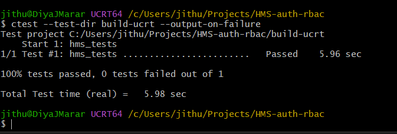
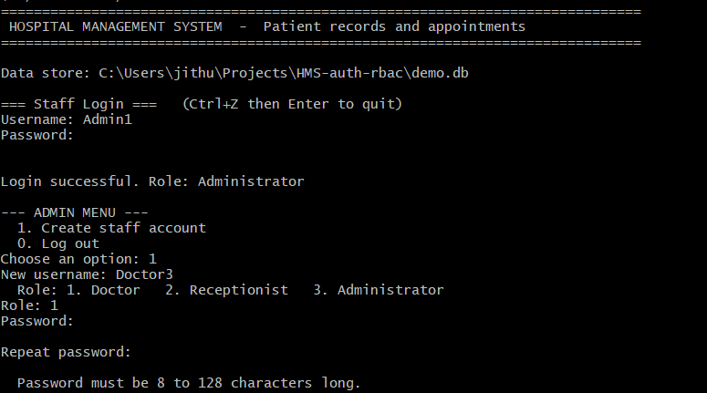
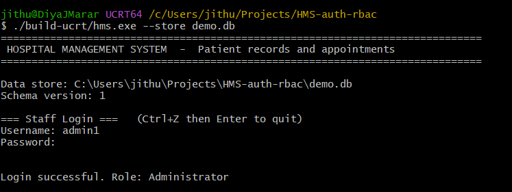
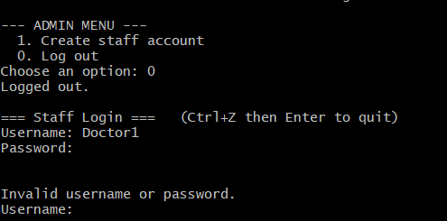
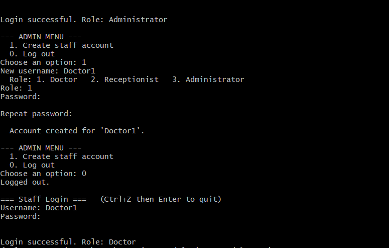
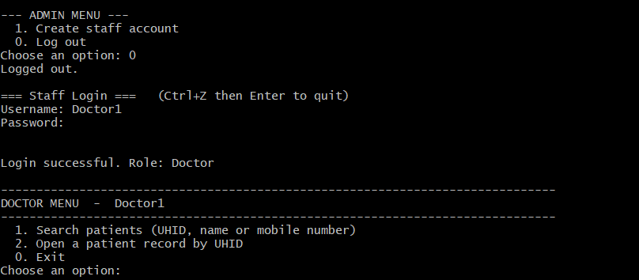
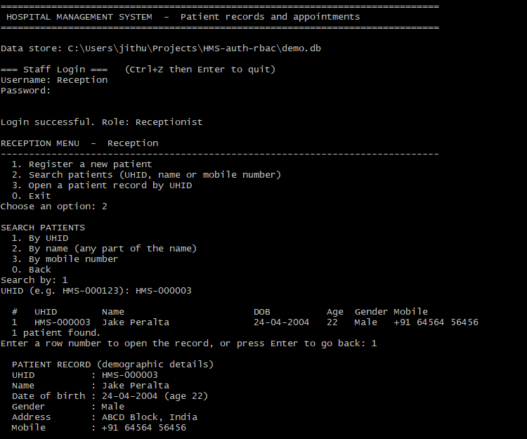
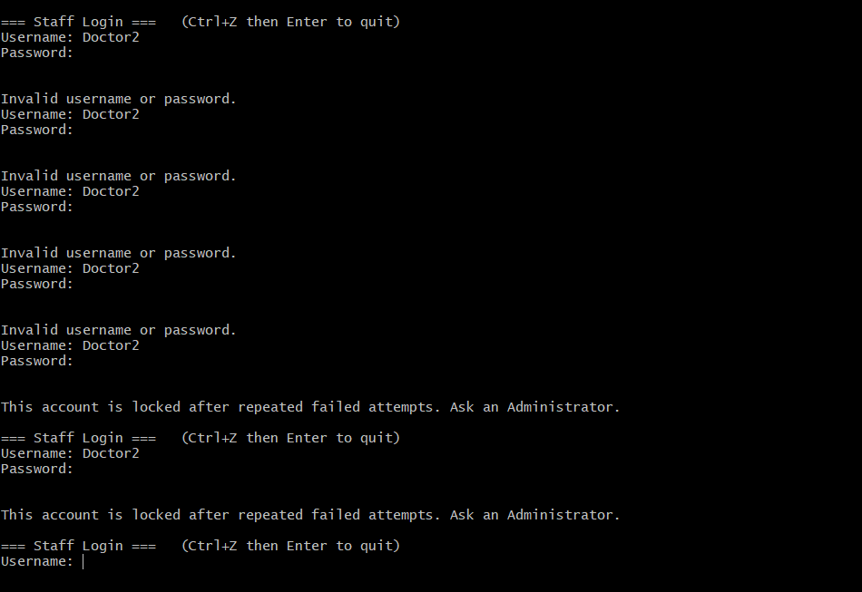

# Sprint 1 test results: staff authentication and RBAC (#3)

Tester: Diya J Marar
Build: branch `feature/staff-auth-integration`, MSYS2 UCRT64 (GCC 15.1.0), CMake + Ninja

Only tests that were actually run are marked Pass. Tests not run are marked Not run.

**Summary:** 10 tests run (A-01 to A-10), 10 passed, 0 failed. 3 items are not implemented (A-11 to A-13) and are planned for Sprint 2.

## Test cases

| ID | Test | Expected | Actual | Result |
|---|---|---|---|---|
| A-01 | Automated suite (`ctest --test-dir build-ucrt`) | All tests pass | 100% passed, 0 failed | Pass |
| A-02 | Create a staff account with a weak password (too short) | Rejected with a policy message | Rejected: "Password must be 8 to 128 characters long." (Admin menu) | Pass |
| A-03 | First start: strong Administrator password | Administrator account created | "Administrator account created." | Pass |
| A-04 | Login with a wrong password | "Invalid username or password." | Message shown; it does not say which part was wrong | Pass |
| A-05 | Admin creates Doctor and Receptionist accounts | "Account created for ..." | Accounts created | Pass |
| A-06 | Doctor login routes to the Doctor menu | "Role: Doctor" and DOCTOR MENU | As expected | Pass |
| A-07 | Doctor cannot register patients | No registration option | Doctor menu shows search and open record only | Pass |
| A-08 | Receptionist registers and searches a patient | Patient saved and found by search | As expected, including the duplicate-review screen | Pass |
| A-09 | 5 wrong passwords lock the account | Locked on the 5th attempt; locked state persists | 4 x "Invalid", 5th: "locked after repeated failed attempts", next login refused as locked | Pass |
| A-10 | Password stored only as a salted Argon2id hash | Hash starts with `$argon2id$` and differs per user | Verified by an automated test (part of A-01) | Pass |
| A-11 | Lockout cooldown and automatic unlock | Not implemented | Not run | Planned, Sprint 2 (D-16) |
| A-12 | Audit entries for login success, failure and lockout | Not implemented | Not run | Planned, Sprint 2 (D-17) |
| A-13 | Admin unlock, password reset, deactivate account | Not implemented | Not run | Planned, Sprint 2 (D-15) |

Known limitations are recorded in `docs/deviation-log.md` (D-15 to D-18).

## Evidence

### A-01: Automated tests
Command: `ctest --test-dir build-ucrt --output-on-failure`. Result: 100% passed, 0 failed. This run also covers A-10.

---

### A-02: Weak password rejected
Admin menu, creating `Doctor3` with a too-short password. Result: rejected with a policy message.

---

### A-03: Administrator created at first start
Empty data store, strong password. Result: "Administrator account created."

---

### A-04: Wrong password refused
Result: "Invalid username or password." The message does not reveal which part was wrong.

---

### A-05: Admin creates staff accounts
Admin menu, option 1, creating Doctor and Receptionist accounts.

---

### A-06 and A-07: Doctor menu has no registration
Login as a Doctor shows "Role: Doctor" and a menu with search and open record only.

---

### A-08: Receptionist registers and searches
Login as a Receptionist, register a patient, then find them by search.

---

### A-09: Account lockout
Five wrong passwords for `Doctor2`. Result: locked on the 5th attempt, and the next login is refused as locked.

